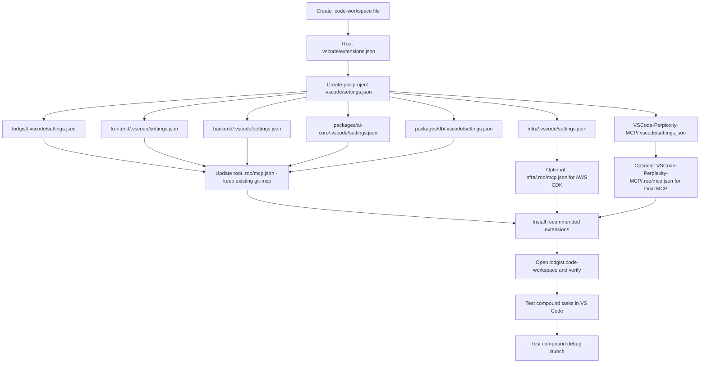

# Lodgist Multi-Root VS Code Workspace Specification

> **Date:** 2026-05-14
> **Author:** Roo (Architect)
> **Project:** Lodgist — Nigerian real-estate trust & escrow platform
> **Repo root:** `/home/shadowweaver/Desktop/lodgist`

---

## Table of Contents

1. [`lodgist.code-workspace` — Multi-Root Workspace File](#1-lodgistcodeworkspace--multi-root-workspace-file)
   - [1.1 Folders](#11-folders)
   - [1.2 Shared Workspace Settings](#12-shared-workspace-settings)
   - [1.3 Per-Folder Overrides](#13-per-folder-overrides)
   - [1.4 Launch Configurations (Compound Debug)](#14-launch-configurations-compound-debug)
   - [1.5 Compound Tasks](#15-compound-tasks)
   - [1.6 Extension Recommendations Section](#16-extension-recommendations-section)
2. [Per-Project `.vscode/settings.json` Files](#2-per-project-vscodesettingsjson-files)
   - [2.1 `lodgist/` — Main Next.js App](#21-lodgist--main-nextjs-app)
   - [2.2 `frontend/` — Secondary Next.js App](#22-frontend--secondary-nextjs-app)
   - [2.3 `backend/` — Express API](#23-backend--express-api)
   - [2.4 `packages/ai-core/` — Fraud Detection Service](#24-packagesai-core--fraud-detection-service)
   - [2.5 `packages/db/` — Prisma Database Layer](#25-packagesdb--prisma-database-layer)
   - [2.6 `infra/` — AWS CDK Infrastructure](#26-infra--aws-cdk-infrastructure)
   - [2.7 `VSCode-Perplexity-MCP/` — Perplexity MCP Extension](#27-vscode-perplexity-mcp--perplexity-mcp-extension)
3. [Extension Recommendations (5 Tiers)](#3-extension-recommendations-5-tiers)
4. [Roo Code MCP Configuration](#4-roo-code-mcp-configuration)
   - [4.1 Global (Home Directory) `.roo/mcp.json`](#41-global-home-directory-roomcpjson)
   - [4.2 Per-Project `.roo/mcp.json` Files](#42-per-project-roomcpjson-files)
5. [Implementation Order](#5-implementation-order)

---

## 1. `lodgist.code-workspace` — Multi-Root Workspace File

### 1.1 Folders

Seven folders, each with an emoji prefix for quick visual identification in the VS Code title bar and Explorer:

| # | Emoji | Name | Path | Port | Language/Runtime |
|---|-------|------|------|------|-----------------|
| 1 | 🏠 | Lodgist (app) | `./lodgist` | 3000 | Next.js 16, TypeScript |
| 2 | 🎨 | Frontend | `./frontend` | 3001 | Next.js 16, TypeScript |
| 3 | ⚙️ | Backend | `./backend` | 4000 | Express, JavaScript |
| 4 | 🧠 | AI Core | `./packages/ai-core` | 4001 | Express, JavaScript |
| 5 | 🗄️ | DB | `./packages/db` | — | Prisma, TypeScript |
| 6 | ☁️ | Infra | `./infra` | — | AWS CDK, TypeScript |
| 7 | 🔌 | Perplexity MCP | `./VSCode-Perplexity-MCP` | — | VS Code Extension, TypeScript |

### 1.2 Shared Workspace Settings

These apply to **all** workspace folders unless overridden.

```jsonc
"settings": {
  // ── Editor ──────────────────────────────────────────────────────────
  "editor.formatOnSave": true,
  "editor.defaultFormatter": "esbenp.prettier-vscode",
  "editor.codeActionsOnSave": {
    "source.fixAll.eslint": "explicit",
    "source.organizeImports": "never"
  },
  "editor.rulers": [80, 100, 120],
  "editor.renderWhitespace": "boundary",
  "editor.tabSize": 2,
  "editor.detectIndentation": false,
  "editor.bracketPairColorization.enabled": true,
  "editor.guides.bracketPairs": true,
  "editor.minimap.enabled": false,

  // ── Files ───────────────────────────────────────────────────────────
  "files.exclude": {
    "**/node_modules/": true,
    "**/.git/": true,
    "**/dist/": true,
    "**/.next/": true,
    "**/coverage/": true
  },
  "files.insertFinalNewline": true,
  "files.trimTrailingWhitespace": true,
  "files.associations": {
    "*.prisma": "prisma",
    ".env.example": "dotenv",
    ".env.*": "dotenv"
  },

  // ── Search ──────────────────────────────────────────────────────────
  "search.exclude": {
    "**/node_modules": true,
    "**/dist": true,
    "**/.next": true,
    "**/coverage": true,
    "**/.git": true,
    "**/pnpm-lock.yaml": true,
    "**/package-lock.json": true,
    "**/*.mhtml": true
  },

  // ── Terminal ────────────────────────────────────────────────────────
  "terminal.integrated.defaultLocation": "editor",
  "terminal.integrated.enableMultiLinePasteWarning": "always",

  // ── NPM / PNPM ──────────────────────────────────────────────────────
  "npm.packageManager": "pnpm",
  "npm-intellisense.scopeDevDependencies": true,

  // ── TypeScript ──────────────────────────────────────────────────────
  "typescript.enablePromptUseWorkspaceTsdk": true,
  "typescript.tsdk": "node_modules/typescript/lib",
  "typescript.preferences.importModuleSpecifier": "relative",

  // ── Git ─────────────────────────────────────────────────────────────
  "git.enableSmartCommit": true,
  "git.autofetch": true,
  "git.confirmSync": false,
  "git.inputValidationSubjectLength": 72,

  // ── Languages ───────────────────────────────────────────────────────
  "[prisma]": {
    "editor.defaultFormatter": "Prisma.prisma"
  },
  "[javascript]": {
    "editor.defaultFormatter": "esbenp.prettier-vscode"
  },
  "[typescript]": {
    "editor.defaultFormatter": "esbenp.prettier-vscode"
  },
  "[typescriptreact]": {
    "editor.defaultFormatter": "esbenp.prettier-vscode"
  },
  "[json]": {
    "editor.defaultFormatter": "esbenp.prettier-vscode"
  },
  "[jsonc]": {
    "editor.defaultFormatter": "esbenp.prettier-vscode"
  },
  "[markdown]": {
    "editor.defaultFormatter": "yzhang.markdown-all-in-one"
  },
  "[css]": {
    "editor.defaultFormatter": "esbenp.prettier-vscode"
  },
  "[dockerfile]": {
    "editor.defaultFormatter": "ms-azuretools.vscode-docker"
  },

  // ── Miscellaneous ───────────────────────────────────────────────────
  "workbench.colorCustomizations": {
    "titleBar.activeForeground": "#e7e7e7",
    "titleBar.inactiveForeground": "#e7e7e799",
    "titleBar.activeBackground": "#0f1a2e",
    "titleBar.inactiveBackground": "#0f1a2e99"
  },
  "window.title": "${dirty}${activeFolderShort}${separator}${rootName}${separator}${appName}",
  "workbench.editor.labelFormat": "short",
  "extensions.ignoreRecommendations": false,
  "telemetry.telemetryLevel": "off"
}
```

### 1.3 Per-Folder Overrides

Each override key uses the `${workspaceFolder:🏠 Lodgist (app)}` syntax. These augment/replace shared settings for a specific sub-project.

```jsonc
// ── 🏠 Lodgist (app) — Main Next.js App ────────────────────────────
"${workspaceFolder:🏠 Lodgist (app)}.files.exclude": {
  "**/node_modules/": true,
  "**/.next/": true,
  "**/coverage/": true
},
"${workspaceFolder:🏠 Lodgist (app)}.vitest.nodeEnv": "test",
"${workspaceFolder:🏠 Lodgist (app)}.vitest.configFile": "${workspaceFolder:🏠 Lodgist (app)}/vitest.config.ts",

// ── 🎨 Frontend — Secondary Next.js App ─────────────────────────────
"${workspaceFolder:🎨 Frontend}.files.exclude": {
  "**/node_modules/": true,
  "**/.next/": true
},

// ── ⚙️ Backend — Express API (JS) ───────────────────────────────────
"${workspaceFolder:⚙️ Backend}.files.exclude": {
  "**/node_modules/": true
},
"${workspaceFolder:⚙️ Backend}.eslint.validate": ["javascript"],
"${workspaceFolder:⚙️ Backend}.files.associations": {
  "*.js": "javascript"
},
"${workspaceFolder:⚙️ Backend}.vitest.configFile": "${workspaceFolder:⚙️ Backend}/vitest.config.js",

// ── 🧠 AI Core — Fraud Detection Service (JS) ───────────────────────
"${workspaceFolder:🧠 AI Core}.files.exclude": {
  "**/node_modules/": true
},
"${workspaceFolder:🧠 AI Core}.eslint.validate": ["javascript"],
"${workspaceFolder:🧠 AI Core}.vitest.configFile": "${workspaceFolder:🧠 AI Core}/vitest.config.js",

// ── 🗄️ DB — Prisma Database Layer ──────────────────────────────────
"${workspaceFolder:🗄️ DB}.files.exclude": {
  "**/node_modules/": true
},
"${workspaceFolder:🗄️ DB}.files.associations": {
  "*.prisma": "prisma"
},
// DB layer doesn't need a test runner config; use the shared Prisma formatter

// ── ☁️ Infra — AWS CDK ──────────────────────────────────────────────
"${workspaceFolder:☁️ Infra}.files.exclude": {
  "**/node_modules/": true,
  "**/coverage/": true,
  "**/cdk.out/": true
},
"${workspaceFolder:☁️ Infra}.jest.configFile": "${workspaceFolder:☁️ Infra}/jest.config.js",
"${workspaceFolder:☁️ Infra}.jest.runMode": "on-save",

// ── 🔌 Perplexity MCP — VS Code Extension ───────────────────────────
"${workspaceFolder:🔌 Perplexity MCP}.files.exclude": {
  "**/node_modules/": true,
  "**/dist/": true
},
"${workspaceFolder:🔌 Perplexity MCP}.files.associations": {
  "*.js": "javascript",
  "*.ts": "typescript"
},
"${workspaceFolder:🔌 Perplexity MCP}.eslint.validate": ["typescript", "javascript"],
// This project has its own vitest.config.ts at root
"${workspaceFolder:🔌 Perplexity MCP}.vitest.configFile": "${workspaceFolder:🔌 Perplexity MCP}/vitest.config.ts"
```

### 1.4 Launch Configurations (Compound Debug)

Four individual server launches plus a compound "All Servers" launch that starts everything in parallel.

```jsonc
"launch": {
  "version": "0.2.0",
  "configurations": [
    // ── 🏠 Lodgist (app) — Next.js 16 (port 3000) ────────────────
    {
      "name": "🏠 Lodgist (app) — Next.js",
      "type": "node-terminal",
      "request": "launch",
      "command": "pnpm dev",
      "cwd": "${workspaceFolder:🏠 Lodgist (app)}",
      "serverReadyAction": {
        "action": "debugWithEdge",
        "pattern": "\\>\\s+Local:\\s+(https?://[^\\s]+)",
        "uriFormat": "%s",
        "webRoot": "${workspaceFolder:🏠 Lodgist (app)}"
      },
      "env": {
        "PORT": "3000",
        "NODE_ENV": "development"
      }
    },
    // ── 🎨 Frontend — Next.js 16 (port 3001) ─────────────────────
    {
      "name": "🎨 Frontend — Next.js",
      "type": "node-terminal",
      "request": "launch",
      "command": "pnpm dev",
      "cwd": "${workspaceFolder:🎨 Frontend}",
      "serverReadyAction": {
        "action": "debugWithEdge",
        "pattern": "\\>\\s+Local:\\s+(https?://[^\\s]+)",
        "uriFormat": "%s",
        "webRoot": "${workspaceFolder:🎨 Frontend}"
      },
      "env": {
        "PORT": "3001",
        "NODE_ENV": "development"
      }
    },
    // ── ⚙️ Backend — Express API (port 4000) ─────────────────────
    {
      "name": "⚙️ Backend — Express API",
      "type": "node-terminal",
      "request": "launch",
      "command": "node --watch src/index.js",
      "cwd": "${workspaceFolder:⚙️ Backend}",
      "env": {
        "PORT": "4000",
        "NODE_ENV": "development"
      },
      "serverReadyAction": {
        "action": "openExternally",
        "pattern": "listening on port (\\d+)",
        "uriFormat": "http://localhost:%s"
      }
    },
    // ── 🧠 AI Core — Fraud Detection (port 4001) ─────────────────
    {
      "name": "🧠 AI Core — Fraud Detection",
      "type": "node-terminal",
      "request": "launch",
      "command": "node --watch src/index.js",
      "cwd": "${workspaceFolder:🧠 AI Core}",
      "env": {
        "PORT": "4001",
        "NODE_ENV": "development"
      },
      "serverReadyAction": {
        "action": "openExternally",
        "pattern": "listening on port (\\d+)",
        "uriFormat": "http://localhost:%s"
      }
    }
  ],
  "compounds": [
    {
      "name": "🚀 All Servers",
      "configurations": [
        "🏠 Lodgist (app) — Next.js",
        "🎨 Frontend — Next.js",
        "⚙️ Backend — Express API",
        "🧠 AI Core — Fraud Detection"
      ],
      "stopAll": true
    }
  ]
}
```

### 1.5 Compound Tasks

Four compound tasks that chain sub-project scripts. Each task uses `"group"` to surface in the VS Code **Terminal > Run Task…** menu.

```jsonc
"tasks": {
  "version": "2.0.0",
  "tasks": [
    // ── Start All ──────────────────────────────────────────────────
    {
      "label": "▶️ Start All Servers",
      "dependsOn": [
        "🏠 lodgist: dev",
        "🎨 frontend: dev",
        "⚙️ backend: dev",
        "🧠 ai-core: dev"
      ],
      "dependsOrder": "parallel",
      "group": {
        "kind": "build",
        "isDefault": true
      },
      "problemMatcher": []
    },
    {
      "label": "🏠 lodgist: dev",
      "type": "shell",
      "command": "pnpm dev",
      "options": { "cwd": "${workspaceFolder:🏠 Lodgist (app)}" },
      "problemMatcher": [],
      "isBackground": true
    },
    {
      "label": "🎨 frontend: dev",
      "type": "shell",
      "command": "pnpm dev",
      "options": { "cwd": "${workspaceFolder:🎨 Frontend}" },
      "problemMatcher": [],
      "isBackground": true
    },
    {
      "label": "⚙️ backend: dev",
      "type": "shell",
      "command": "npm run dev",
      "options": { "cwd": "${workspaceFolder:⚙️ Backend}" },
      "problemMatcher": [],
      "isBackground": true
    },
    {
      "label": "🧠 ai-core: dev",
      "type": "shell",
      "command": "npm run dev",
      "options": { "cwd": "${workspaceFolder:🧠 AI Core}" },
      "problemMatcher": [],
      "isBackground": true
    },

    // ── Test All ───────────────────────────────────────────────────
    {
      "label": "🧪 Test All",
      "dependsOn": [
        "🏠 lodgist: test",
        "⚙️ backend: test",
        "🧠 ai-core: test",
        "🗄️ db: test",
        "☁️ infra: test",
        "🔌 perplexity-mcp: test"
      ],
      "dependsOrder": "parallel",
      "group": { "kind": "test", "isDefault": true },
      "problemMatcher": []
    },
    {
      "label": "🏠 lodgist: test",
      "type": "shell",
      "command": "pnpm test",
      "options": { "cwd": "${workspaceFolder:🏠 Lodgist (app)}" },
      "problemMatcher": ["$vitest"]
    },
    {
      "label": "⚙️ backend: test",
      "type": "shell",
      "command": "npm test",
      "options": { "cwd": "${workspaceFolder:⚙️ Backend}" },
      "problemMatcher": ["$vitest"]
    },
    {
      "label": "🧠 ai-core: test",
      "type": "shell",
      "command": "npm test",
      "options": { "cwd": "${workspaceFolder:🧠 AI Core}" },
      "problemMatcher": ["$vitest"]
    },
    {
      "label": "🗄️ db: test",
      "type": "shell",
      "command": "pnpm test",
      "options": { "cwd": "${workspaceFolder:🗄️ DB}" },
      "problemMatcher": []
    },
    {
      "label": "☁️ infra: test",
      "type": "shell",
      "command": "npm test",
      "options": { "cwd": "${workspaceFolder:☁️ Infra}" },
      "problemMatcher": ["$jest"]
    },
    {
      "label": "🔌 perplexity-mcp: test",
      "type": "shell",
      "command": "npm test",
      "options": { "cwd": "${workspaceFolder:🔌 Perplexity MCP}" },
      "problemMatcher": ["$vitest"]
    },

    // ── Build All ──────────────────────────────────────────────────
    {
      "label": "📦 Build All",
      "dependsOn": [
        "🏠 lodgist: build",
        "🎨 frontend: build",
        "☁️ infra: build",
        "🔌 perplexity-mcp: build"
      ],
      "dependsOrder": "parallel",
      "group": { "kind": "build" },
      "problemMatcher": []
    },
    {
      "label": "🏠 lodgist: build",
      "type": "shell",
      "command": "pnpm build",
      "options": { "cwd": "${workspaceFolder:🏠 Lodgist (app)}" },
      "problemMatcher": ["$tsc"]
    },
    {
      "label": "🎨 frontend: build",
      "type": "shell",
      "command": "pnpm build",
      "options": { "cwd": "${workspaceFolder:🎨 Frontend}" },
      "problemMatcher": ["$tsc"]
    },
    {
      "label": "☁️ infra: build",
      "type": "shell",
      "command": "npm run build",
      "options": { "cwd": "${workspaceFolder:☁️ Infra}" },
      "problemMatcher": ["$tsc"]
    },
    {
      "label": "🔌 perplexity-mcp: build",
      "type": "shell",
      "command": "npm run build",
      "options": { "cwd": "${workspaceFolder:🔌 Perplexity MCP}" },
      "problemMatcher": ["$tsc"]
    },

    // ── Install All ────────────────────────────────────────────────
    {
      "label": "📥 Install All Dependencies",
      "dependsOn": [
        "🏠 lodgist: install",
        "🎨 frontend: install",
        "⚙️ backend: install",
        "🧠 ai-core: install",
        "🗄️ db: install",
        "☁️ infra: install",
        "🔌 perplexity-mcp: install"
      ],
      "dependsOrder": "parallel",
      "group": { "kind": "none" },
      "problemMatcher": []
    },
    {
      "label": "🏠 lodgist: install",
      "type": "shell",
      "command": "pnpm install",
      "options": { "cwd": "${workspaceFolder:🏠 Lodgist (app)}" }
    },
    {
      "label": "🎨 frontend: install",
      "type": "shell",
      "command": "pnpm install",
      "options": { "cwd": "${workspaceFolder:🎨 Frontend}" }
    },
    {
      "label": "⚙️ backend: install",
      "type": "shell",
      "command": "npm install",
      "options": { "cwd": "${workspaceFolder:⚙️ Backend}" }
    },
    {
      "label": "🧠 ai-core: install",
      "type": "shell",
      "command": "pnpm install",
      "options": { "cwd": "${workspaceFolder:🧠 AI Core}" }
    },
    {
      "label": "🗄️ db: install",
      "type": "shell",
      "command": "pnpm install",
      "options": { "cwd": "${workspaceFolder:🗄️ DB}" }
    },
    {
      "label": "☁️ infra: install",
      "type": "shell",
      "command": "npm install",
      "options": { "cwd": "${workspaceFolder:☁️ Infra}" }
    },
    {
      "label": "🔌 perplexity-mcp: install",
      "type": "shell",
      "command": "npm install",
      "options": { "cwd": "${workspaceFolder:🔌 Perplexity MCP}" }
    }
  ]
}
```

### 1.6 Extension Recommendations Section

In the `.code-workspace` file, an `extensions` block merges all tier-specific IDs plus the 3 existing recommendations from [`lodgist/.vscode/extensions.json`](../.vscode/extensions.json:1).

```jsonc
"extensions": {
  "recommendations": [
    // ── TIER 1: Essential (must-have for any contributor) ─────────
    "esbenp.prettier-vscode",                 // Prettier — code formatter
    "dbaeumer.vscode-eslint",                 // ESLint — linting
    "bradlc.vscode-tailwindcss",              // Tailwind CSS IntelliSense
    "Prisma.prisma",                          // Prisma — schema & migration support
    "ms-azuretools.vscode-docker",            // Docker — container management
    "eamodio.gitlens",                        // GitLens — git supercharged
    "vivaxy.vscode-conventional-commits",     // Conventional Commits
    "github.vscode-github-actions",           // GitHub Actions — CI/CD visibility
    "RooVeterinaryInc.roo-cline",             // Roo Code — AI coding agent

    // ── TIER 2: Recommended (great for daily dev) ─────────────────
    "yzhang.markdown-all-in-one",             // Markdown preview & editing
    "christian-kohler.npm-intellisense",      // npm/pnpm import completion
    "christian-kohler.path-intellisense",     // Path autocomplete
    "streetsidesoftware.code-spell-checker",  // Spell checker
    "mikestead.dotenv",                       // .env syntax highlighting
    "gruntfuggly.todo-tree",                  // TODO/FIXME tracker
    "tamasfe.even-better-toml",               // TOML (for Rust/Copilot manifests)
    "redhat.vscode-yaml",                     // YAML validation & autocomplete

    // ── TIER 3: Frontend (Next.js / React / shadcn) ──────────────
    "formulahendry.auto-rename-tag",          // Auto-rename paired tags
    "formulahendry.auto-close-tag",           // Auto-close HTML/JSX tags
    "dsznajder.es7-react-js-snippets",        // React/JSX snippets
    "aaron-bond.better-comments",             // Color-coded comments
    "naumovs.color-highlight",               // Color value highlighting
    "bierner.color-info",                    // CSS color info on hover

    // ── TIER 4: Backend / Infra (Express, CDK, PostgreSQL) ───────
    "ms-kubernetes-tools.vscode-kubernetes-tools", // K8s (existing)
    "cweijan.vscode-postgresql-client2",     // PostgreSQL client
    "ms-vscode.vscode-typescript-next",       // Latest TypeScript features
    "hbenl.vscode-test-explorer",            // Test Explorer UI
    "zixuanchen.vitest-explorer",            // Vitest Explorer
    "Orta.vscode-jest",                      // Jest (for infra tests)
    "amazonwebservices.aws-toolkit-vscode",   // AWS Toolkit (CDK / Lambda / ECS)

    // ── TIER 5: Nice-to-Have (polish, DX enhancements) ───────────
    "thekrishnarajput.perplexity-copilot",    // Perplexity Copilot (existing)
    "wassimdev.wassimdev-vscode-deepseek",    // DeepSeek inline (existing)
    "github.copilot",                        // GitHub Copilot
    "github.copilot-chat",                   // Copilot Chat
    "mhutchie.git-graph",                    // Git Graph
    "wix.vscode-import-cost",                // Import size analyzer
    "pflannery.vscode-versionlens",          // Version lens for package.json
    "bierner.markdown-mermaid",              // Mermaid diagram preview
    "alefragnani.project-manager",           // Project switching
    "hediet.vscode-drawio",                  // draw.io diagrams in VS Code
    "jebbs.plantuml"                         // PlantUML diagrams
  ],
  "unwantedRecommendations": []
}
```

---

## 2. Per-Project `.vscode/settings.json` Files

Each sub-project gets a `.vscode/settings.json` with **only** the settings unique to that project. Shared settings live in the `.code-workspace` file instead.

### 2.1 `lodgist/` — Main Next.js App

*Path: [`lodgist/.vscode/settings.json`](../lodgist/.vscode/settings.json)*

```jsonc
{
  // ── Vitest ──────────────────────────────────────────────────────────
  "vitest.configFile": "vitest.config.ts",
  "vitest.nodeEnv": "test",

  // ── TypeScript ──────────────────────────────────────────────────────
  "typescript.tsdk": "node_modules/typescript/lib",
  "typescript.preferences.importModuleSpecifier": "shortest",

  // ── ESLint ──────────────────────────────────────────────────────────
  "eslint.validate": [
    "typescript",
    "typescriptreact"
  ],

  // ── Tailwind ────────────────────────────────────────────────────────
  "tailwindCSS.experimental.configFile": "tailwind.config.ts",
  "tailwindCSS.classAttributes": [
    "class",
    "className",
    "ngClass"
  ],

  // ── Playwright (e2e) ────────────────────────────────────────────────
  "playwright.config": "playwright.config.ts",
  "playwright.env": {
    "BASE_URL": "http://localhost:3000"
  },

  // ── Files ───────────────────────────────────────────────────────────
  "files.exclude": {
    "**/node_modules/": true,
    "**/.next/": true,
    "**/coverage/": true
  },

  // ── Search ──────────────────────────────────────────────────────────
  "search.exclude": {
    "**/.next": true,
    "**/coverage": true,
    "**/pnpm-lock.yaml": true
  }
}
```

### 2.2 `frontend/` — Secondary Next.js App

*Path: [`frontend/.vscode/settings.json`](../frontend/.vscode/settings.json)*

```jsonc
{
  // ── TypeScript ──────────────────────────────────────────────────────
  "typescript.tsdk": "node_modules/typescript/lib",
  "typescript.preferences.importModuleSpecifier": "shortest",

  // ── ESLint ──────────────────────────────────────────────────────────
  "eslint.validate": [
    "typescript",
    "typescriptreact"
  ],

  // ── Tailwind ────────────────────────────────────────────────────────
  "tailwindCSS.experimental.configFile": "tailwind.config.ts",
  "tailwindCSS.classAttributes": [
    "class",
    "className",
    "ngClass"
  ],

  // ── Files ───────────────────────────────────────────────────────────
  "files.exclude": {
    "**/node_modules/": true,
    "**/.next/": true
  },

  // ── Search ──────────────────────────────────────────────────────────
  "search.exclude": {
    "**/.next": true,
    "**/pnpm-lock.yaml": true
  }
}
```

### 2.3 `backend/` — Express API

*Path: [`backend/.vscode/settings.json`](../backend/.vscode/settings.json)*

```jsonc
{
  // ── Vitest ──────────────────────────────────────────────────────────
  "vitest.configFile": "vitest.config.js",
  "vitest.nodeEnv": "test",

  // ── ESLint ──────────────────────────────────────────────────────────
  "eslint.validate": ["javascript"],

  // ── Files ───────────────────────────────────────────────────────────
  "files.exclude": {
    "**/node_modules/": true
  },
  "files.associations": {
    "*.js": "javascript"
  },

  // ── Search ──────────────────────────────────────────────────────────
  "search.exclude": {
    "**/package-lock.json": true
  },

  // ── Terminal color (visual indicator) ───────────────────────────────
  "terminal.integrated.tabStopWidth": 4,
  "workbench.colorCustomizations": {
    "terminal.background": "#1a1a2e"
  }
}
```

### 2.4 `packages/ai-core/` — Fraud Detection Service

*Path: [`packages/ai-core/.vscode/settings.json`](../packages/ai-core/.vscode/settings.json)*

```jsonc
{
  // ── Vitest ──────────────────────────────────────────────────────────
  "vitest.configFile": "vitest.config.js",
  "vitest.nodeEnv": "test",

  // ── ESLint ──────────────────────────────────────────────────────────
  "eslint.validate": ["javascript"],

  // ── Prisma ──────────────────────────────────────────────────────────
  "prisma.fileWatcher": true,

  // ── Files ───────────────────────────────────────────────────────────
  "files.exclude": {
    "**/node_modules/": true
  },

  // ── Search ──────────────────────────────────────────────────────────
  "search.exclude": {
    "**/pnpm-lock.yaml": true
  },

  // ── Terminal color (visual indicator) ───────────────────────────────
  "workbench.colorCustomizations": {
    "terminal.background": "#1e2a1e"
  }
}
```

### 2.5 `packages/db/` — Prisma Database Layer

*Path: [`packages/db/.vscode/settings.json`](../packages/db/.vscode/settings.json)*

```jsonc
{
  // ── Prisma ──────────────────────────────────────────────────────────
  "prisma.fileWatcher": true,

  // ── Files ───────────────────────────────────────────────────────────
  "files.exclude": {
    "**/node_modules/": true
  },
  "files.associations": {
    "*.prisma": "prisma"
  },

  // ── Search ──────────────────────────────────────────────────────────
  "search.exclude": {
    "**/pnpm-lock.yaml": true
  },

  // ── Terminal color (visual indicator) ───────────────────────────────
  "workbench.colorCustomizations": {
    "terminal.background": "#1e1e2e"
  }
}
```

### 2.6 `infra/` — AWS CDK Infrastructure

*Path: [`infra/.vscode/settings.json`](../infra/.vscode/settings.json)*

```jsonc
{
  // ── Jest (CDK uses Jest, not vitest) ────────────────────────────────
  "jest.configFile": "jest.config.js",
  "jest.runMode": "on-save",

  // ── TypeScript ──────────────────────────────────────────────────────
  "typescript.tsdk": "node_modules/typescript/lib",
  "typescript.preferences.importModuleSpecifier": "relative",

  // ── ESLint ──────────────────────────────────────────────────────────
  "eslint.validate": ["typescript"],

  // ── AWS Toolkit ─────────────────────────────────────────────────────
  "aws.sam.debugging.activate": false,
  "aws.region": "eu-west-2",

  // ── Files ───────────────────────────────────────────────────────────
  "files.exclude": {
    "**/node_modules/": true,
    "**/coverage/": true,
    "**/cdk.out/": true
  },

  // ── Search ──────────────────────────────────────────────────────────
  "search.exclude": {
    "**/cdk.out": true,
    "**/coverage": true,
    "**/package-lock.json": true
  }
}
```

### 2.7 `VSCode-Perplexity-MCP/` — Perplexity MCP Extension

*Path: [`VSCode-Perplexity-MCP/.vscode/settings.json`](../VSCode-Perplexity-MCP/.vscode/settings.json)*

```jsonc
{
  // ── Vitest ──────────────────────────────────────────────────────────
  "vitest.configFile": "vitest.config.ts",
  "vitest.nodeEnv": "test",

  // ── TypeScript ──────────────────────────────────────────────────────
  "typescript.tsdk": "node_modules/typescript/lib",
  "typescript.preferences.importModuleSpecifier": "relative",

  // ── ESLint ──────────────────────────────────────────────────────────
  "eslint.validate": ["typescript", "javascript"],

  // ── Extension development ───────────────────────────────────────────
  "debug.javascript.autoAttachFilter": "onlyWithFlag",
  "debug.toolBarLocation": "floating",

  // ── Files ───────────────────────────────────────────────────────────
  "files.exclude": {
    "**/node_modules/": true,
    "**/dist/": true,
    "**/.git/": true
  },
  "files.associations": {
    "*.js": "javascript",
    "*.ts": "typescript"
  },

  // ── Search ──────────────────────────────────────────────────────────
  "search.exclude": {
    "**/dist": true,
    "**/package-lock.json": true
  },

  // ── Terminal color (visual indicator) ───────────────────────────────
  "workbench.colorCustomizations": {
    "terminal.background": "#2a1e2e",
    "terminal.foreground": "#d4b0e0"
  }
}
```

---

## 3. Extension Recommendations (5 Tiers)

All tiers are already embedded in the `.code-workspace` file (section 1.6). This section exists for reference, documentation, and cases where a contributor is not using the workspace file.

### Tier 1: Essential

| Extension | ID | Purpose |
|-----------|-----|---------|
| Prettier | `esbenp.prettier-vscode` | Universal code formatter |
| ESLint | `dbaeumer.vscode-eslint` | Linting all JS/TS |
| Tailwind CSS IntelliSense | `bradlc.vscode-tailwindcss` | Tailwind class autocomplete |
| Prisma | `Prisma.prisma` | Prisma schema editor + formatter |
| Docker | `ms-azuretools.vscode-docker` | Dockerfile / Compose support |
| GitLens | `eamodio.gitlens` | Git blame, history, annotations |
| Conventional Commits | `vivaxy.vscode-conventional-commits` | Commit message format |
| GitHub Actions | `github.vscode-github-actions` | CI/CD workflow visibility |
| Roo Code | `RooVeterinaryInc.roo-cline` | AI coding agent (in use) |

### Tier 2: Recommended

| Extension | ID | Purpose |
|-----------|-----|---------|
| Markdown All-in-One | `yzhang.markdown-all-in-one` | Markdown editing |
| npm IntelliSense | `christian-kohler.npm-intellisense` | Import completion |
| Path IntelliSense | `christian-kohler.path-intellisense` | Path autocomplete |
| Code Spell Checker | `streetsidesoftware.code-spell-checker` | Spell check |
| dotenv | `mikestead.dotenv` | `.env` highlighting |
| Todo Tree | `gruntfuggly.todo-tree` | TODO/FIXME tracker |
| Even Better TOML | `tamasfe.even-better-toml` | TOML support |
| YAML | `redhat.vscode-yaml` | YAML validation |

### Tier 3: Frontend (Next.js / React / shadcn)

| Extension | ID | Purpose |
|-----------|-----|---------|
| Auto Rename Tag | `formulahendry.auto-rename-tag` | Paired tag renaming |
| Auto Close Tag | `formulahendry.auto-close-tag` | Auto-close HTML/JSX |
| ES7+ React/Redux/React-Native snippets | `dsznajder.es7-react-js-snippets` | React snippets |
| Better Comments | `aaron-bond.better-comments` | Color-coded comments |
| Color Highlight | `naumovs.color-highlight` | CSS color preview |
| Color Info | `bierner.color-info` | CSS color hover info |

### Tier 4: Backend / Infra

| Extension | ID | Purpose |
|-----------|-----|---------|
| Kubernetes | `ms-kubernetes-tools.vscode-kubernetes-tools` | K8s management |
| PostgreSQL | `cweijan.vscode-postgresql-client2` | DB client |
| TypeScript Nightly | `ms-vscode.vscode-typescript-next` | Latest TS features |
| Test Explorer UI | `hbenl.vscode-test-explorer` | Universal test UI |
| Vitest Explorer | `zixuanchen.vitest-explorer` | Vitest runner UI |
| Jest | `Orta.vscode-jest` | Jest runner (infra) |
| AWS Toolkit | `amazonwebservices.aws-toolkit-vscode` | AWS / CDK support |

### Tier 5: Nice-to-Have

| Extension | ID | Purpose |
|-----------|-----|---------|
| Perplexity Copilot | `thekrishnarajput.perplexity-copilot` | AI search (existing) |
| DeepSeek | `wassimdev.wassimdev-vscode-deepseek` | AI inline (existing) |
| GitHub Copilot | `github.copilot` | AI code completion |
| GitHub Copilot Chat | `github.copilot-chat` | AI chat |
| Git Graph | `mhutchie.git-graph` | Git visualization |
| Import Cost | `wix.vscode-import-cost` | Bundle size hints |
| VersionLens | `pflannery.vscode-versionlens` | Package version hints |
| Markdown Mermaid | `bierner.markdown-mermaid` | Mermaid in markdown |
| Project Manager | `alefragnani.project-manager` | Quick project switching |
| Draw.io | `hediet.vscode-drawio` | Diagrams |
| PlantUML | `jebbs.plantuml` | UML diagrams |

---

## 4. Roo Code MCP Configuration

### 4.1 Global (Home Directory) `.roo/mcp.json`

*Path: `/home/shadowweaver/.roo/mcp.json`*

This provides MCP servers available to **all** projects on this machine.

```jsonc
{
  "mcpServers": {
    // Context7 — documentation & code examples for libraries
    "context7": {
      "type": "streamable-http",
      "url": "https://context7-mcp-server.vercel.app/mcp"
    },
    // GitHub MCP — repository management, PRs, issues
    "github": {
      "type": "streamable-http",
      "url": "https://api.github.com/mcp",
      "headers": {
        "Authorization": "Bearer ${GITHUB_TOKEN}"
      }
    },
    // Perplexity MCP — web search and research (daemon mode)
    "perplexity": {
      "type": "stdio",
      "command": "npx",
      "args": [
        "-y",
        "@exploratoryengineering/perplexity-mcp"
      ],
      "env": {
        "PERPLEXITY_API_KEY": "${PERPLEXITY_API_KEY}",
        "PERPLEXITY_MODEL": "pplx_pro"
      }
    },
    // PostgreSQL — database introspection for the Lodgist DB
    "postgres": {
      "type": "streamable-http",
      "url": "http://localhost:4002/mcp",
      "headers": {
        "X-API-Key": "${POSTGRES_MCP_KEY}"
      }
    },
    // Google Maps Platform — location/map assistance
    "google-maps-platform-code-assist": {
      "type": "streamable-http",
      "url": "https://googlemaps-mcp-codeassist.googleapis.com/mcp",
      "headers": {
        "Authorization": "Bearer ${GOOGLE_MAPS_API_KEY}"
      }
    },
    // File system access
    "filesystem": {
      "type": "stdio",
      "command": "npx",
      "args": [
        "-y",
        "@anthropic/mcp-server-filesystem",
        "/home/shadowweaver/Desktop/lodgist"
      ]
    },
    // Memory/Knowledge Graph
    "memory": {
      "type": "stdio",
      "command": "npx",
      "args": [
        "-y",
        "@anthropic/mcp-server-memory"
      ]
    }
  }
}
```

> **Note:** The existing [`lodgist/.roo/mcp.json`](../.roo/mcp.json:1) defines a `git-mcp` server pointing to `https://gitmcp.io/Shadow7user/Shadow7user/lodgist`. This should be kept as-is in the project-level config.

### 4.2 Per-Project `.roo/mcp.json` Files

Most sub-projects do **not** need a custom `.roo/mcp.json`. Only override when a project requires project-specific MCP servers.

#### Root Project (Lodgist)

*Path: [`lodgist/.roo/mcp.json`](../.roo/mcp.json)* — Already exists with `git-mcp`. Keep it as-is.

#### `VSCode-Perplexity-MCP/`

This project is self-hosting a Perplexity MCP server. If you want Roo Code to use the locally-built MCP server instead of the global one:

*Path: `VSCode-Perplexity-MCP/.roo/mcp.json`*

```jsonc
{
  "mcpServers": {
    "perplexity-local": {
      "type": "stdio",
      "command": "node",
      "args": [
        "${workspaceFolder:🔌 Perplexity MCP}/packages/mcp-server/dist/index.js"
      ],
      "env": {
        "PERPLEXITY_API_KEY": "${PERPLEXITY_API_KEY}",
        "PERPLEXITY_MODEL": "pplx_pro"
      }
    }
  }
}
```

#### `infra/`

*Path: `infra/.roo/mcp.json`*

```jsonc
{
  "mcpServers": {
    "aws-cdk": {
      "type": "stdio",
      "command": "npx",
      "args": [
        "-y",
        "@mcp/cdk-toolkit"
      ],
      "env": {
        "AWS_REGION": "eu-west-2",
        "AWS_PROFILE": "${AWS_PROFILE}"
      }
    }
  }
}
```

All other sub-projects (`frontend/`, `backend/`, `packages/ai-core/`, `packages/db/`) do not need a local `.roo/mcp.json`. They inherit the global config.

---

## 5. Implementation Order



### Step-by-step Implementation

| Step | Action | Files |
|------|--------|-------|
| 1 | Create the multi-root workspace file | [`lodgist.code-workspace`](../lodgist.code-workspace) |
| 2 | Update root extensions.json with all 5 tiers | [`lodgist/.vscode/extensions.json`](../.vscode/extensions.json) |
| 3 | Create per-project `.vscode/settings.json` | 7 files (see [section 2](#2-per-project-vscodesettingsjson-files)) |
| 4 | Preserve existing `lodgist/.roo/mcp.json` | No changes needed |
| 5 | (Optional) Add infra MCP config | [`infra/.roo/mcp.json`](../infra/.roo/mcp.json) |
| 6 | (Optional) Add Perplexity local MCP config | [`VSCode-Perplexity-MCP/.roo/mcp.json`](../VSCode-Perplexity-MCP/.roo/mcp.json) |
| 7 | Open the workspace file and validate | Run "Tasks: Run Task" → "Test All" and "Launch" → "All Servers" |

---

## Appendix: Key Structural Observations

| Observation | Detail |
|-------------|--------|
| **Not a monorepo** | Each sub-project manages its own dependencies independently. No root `pnpm-workspace.yaml` exists. The `packages/` directory is logical grouping, not npm workspaces. |
| **Mixed package managers** | `lodgist/`, `frontend/`, `packages/ai-core/`, `packages/db/` use **pnpm**. `backend/`, `infra/`, `VSCode-Perplexity-MCP/` use **npm**. |
| **Mixed test runners** | **vitest** — lodgist, backend, ai-core, Perplexity MCP. **Jest** — infra. **Playwright** — lodgist e2e. |
| **Mixed languages** | `backend/` and `packages/ai-core/` are **JavaScript** (CommonJS). All others are **TypeScript**. |
| **DB client sharing** | `packages/db/src/client` is `require()`'d by both `backend/` and `packages/ai-core/`. This is a source-level dependency, not a package dependency. |
| **Prisma duplication** | Both `lodgist/` and `packages/ai-core/` have their own `prisma/schema.prisma`. The `packages/db/` layer also has its own schema. Consider consolidation. |
| **Existing `.vscode/extensions.json`** | Contains 3 recommendations. These are preserved and interleaved into Tier 5 (existing) and Tier 4 (K8s). |
