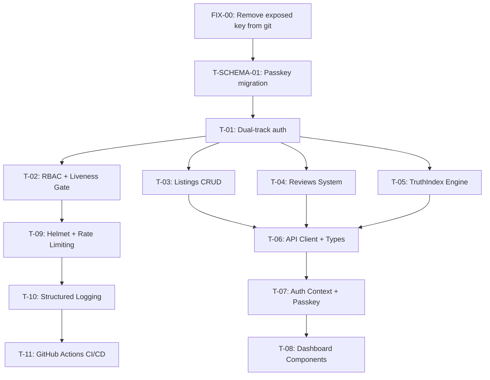

# Lodgist v5.0 Executive Tier — Implementation Plan

## Context Summary (After Deep Codebase Scan)

### Schema Landscape — TWO Schemas Found

| Schema | Location | ID Type | Roles | Used By |
|--------|----------|---------|-------|---------|
| **Main DB** | [`packages/db/prisma/schema.prisma`](../packages/db/prisma/schema.prisma) | `Int` autoincrement | `USER \| ARTISAN \| LANDLORD \| STUDIO_ADMIN` | `backend/` Express API |
| **Next.js App** | [`lodgist/prisma/schema.prisma`](../lodgist/prisma/schema.prisma) | `String` cuid | `ADMIN \| AGENT \| LANDLORD \| TENANT` (via Role model) | `lodgist/` Next.js frontend |

**Critical finding:** The Next.js frontend at [`lodgist/`](../lodgist/) uses NextAuth with its **own** Prisma schema (different User model, string IDs, separate Role table). The backend Express API at [`backend/`](../backend/) uses the MAIN schema with Int IDs. The `frontend/` directory is a minimal/skeleton Next.js app.

### Backend Architecture (Express API — Port 4000)

| Component | Path | Status |
|-----------|------|--------|
| JWT Auth Middleware | [`backend/src/middleware/requireAuth.js`](../backend/src/middleware/requireAuth.js) | ✅ Exists — Bearer JWT verification |
| API Key Auth Middleware | [`backend/src/middleware/auth.js`](../backend/src/middleware/auth.js) | ✅ Exists — x-api-key based (dev bypass) |
| Auth Routes | [`backend/src/routes/auth.js`](../backend/src/routes/auth.js) | ✅ Exists — register/login with JWT |
| Listings CRUD | [`backend/src/routes/listings.js`](../backend/src/routes/listings.js) | ✅ Exists — NO auth guards on mutations |
| Escrow Routes | [`backend/src/routes/escrow.js`](../backend/src/routes/escrow.js) | ✅ Exists — full Paystack flow, NO auth guards |
| Users Routes | [`backend/src/routes/users.js`](../backend/src/routes/users.js) | ✅ Exists — NO admin guards |
| Reviews Routes | -- | ❌ Missing |
| TruthIndex Routes | -- | ❌ Missing |
| WebAuthn Service | -- | ❌ Missing |
| Liveness Gate | -- | ❌ Missing |
| Error Handler | [`backend/src/middleware/errorHandler.js`](../backend/src/middleware/errorHandler.js) | ✅ Exists — Do NOT modify |
| Validation | [`backend/src/middleware/validate.js`](../backend/src/middleware/validate.js) | ✅ Exists |
| Gemini Service | [`backend/src/services/geminiService.js`](../backend/src/services/geminiService.js) | ✅ Exists — Vertex AI integration |
| Trust Protocol | [`backend/src/services/trustProtocolService.js`](../backend/src/services/trustProtocolService.js) | ✅ Exists — `assessRisk()` |
| Trust Safety Engine | [`backend/src/services/trustSafetyEngine.js`](../backend/src/services/trustSafetyEngine.js) | ✅ Exists — wraps all services |
| Trust Service | [`backend/src/services/trustService.js`](../backend/src/services/trustService.js) | ✅ Exists — raw SQL-based, may be legacy |
| Paystack Service | [`backend/src/services/paystackService.js`](../backend/src/services/paystackService.js) | ✅ Exists |
| Scam Detection | [`backend/src/services/listingScamDetection.js`](../backend/src/services/listingScamDetection.js) | ✅ Exists |

### Frontend Landscape

| App | Path | Status |
|-----|------|--------|
| Full Next.js App | [`lodgist/`](../lodgist/) | ✅ Active — shadcn/ui, NextAuth, React 19 |
| Skeleton Frontend | [`frontend/`](../frontend/) | ⚠️ Minimal — has `types.ts` and `api.ts` stubs |

### Security Issue
[`lodgist-deploy-key.json`](../lodgist-deploy-key.json) is committed to repo root and NOT in `.gitignore`.

---

## Execution Plan

The v5.0 manifest provides detailed code for each task. This plan maps those tasks against the actual codebase state, noting where adaptation is needed.

---

### PHASE ZERO: Security Fix + Schema Migration

#### [FIX-00] Remove exposed GCP key from git tracking
- Add `lodgist-deploy-key.json` to [`.gitignore`](../.gitignore)
- `git rm --cached lodgist-deploy-key.json`
- Commit and push

#### [T-SCHEMA-01] Passkey Schema Migration (P0-BLOCKER)
**Target:** [`packages/db/prisma/schema.prisma`](../packages/db/prisma/schema.prisma)
- Add fields to `User` model: `passkeys PasskeyCredential[]`, `isHNW Boolean @default(false)`, `hnwVerifiedAt DateTime?`
- Add new `PasskeyCredential` model with FIDO2 fields
- Install `@simplewebauthn/server` in backend
- Run `npx prisma migrate dev --name add_passkey_credentials`
- Regenerate Prisma client

---

### PHASE 1: Backend API — Authentication & Security

#### [T-01] Dual-Track Authentication System (P0)
**Adaptation needed:** The manifest's [`auth.js`](#) middleware would overwrite the existing API key-based one. Strategy:

1. **REPLACE** [`backend/src/middleware/auth.js`](../backend/src/middleware/auth.js) — The v5.0 manifest provides a full JWT-based middleware with `requireAuth`, `requireRole`, `requireHNW`. This replaces the current API-key-based version.
2. **CREATE** [`backend/src/services/webauthnService.js`](../backend/src/services/webauthnService.js) — FIDO2/WebAuthn service using `@simplewebauthn/server`
3. **REWRITE** [`backend/src/routes/auth.js`](../backend/src/routes/auth.js) — Expand from factory function pattern to include passkey endpoints. **Note:** Current auth.js uses `module.exports = (prisma) => { ... }` pattern — the manifest version doesn't wrap in a factory. Adapt to keep the factory pattern consistent with other routes.
4. **MODIFY** [`backend/src/index.js`](../backend/src/index.js) — Already has auth router mounted at `/api/auth`. Only need to add passkey guard and update imports.
5. Add new env vars to [`backend/.env.example`](../backend/.env.example): `JWT_SECRET`, `WEBAUTHN_ENABLED`, `WEBAUTHN_RP_NAME`, `WEBAUTHN_RP_ID`, `WEBAUTHN_ORIGIN`

#### [T-02] RBAC + Liveness Gate (P0)
1. **CREATE** [`backend/src/middleware/livenessGate.js`](../backend/src/middleware/livenessGate.js) — HNW transaction guard
2. **MODIFY** [`backend/src/routes/listings.js`](../backend/src/routes/listings.js) — Add `requireAuth` + `requireRole` to POST/PUT/DELETE
3. **MODIFY** [`backend/src/routes/users.js`](../backend/src/routes/users.js) — Add `STUDIO_ADMIN` guard to admin routes (PUT/DELETE)
4. **MODIFY** [`backend/src/routes/escrow.js`](../backend/src/routes/escrow.js) — Inject `livenessGate` on high-value create route

#### [T-03] Listings & Properties CRUD (P1)
**Note:** The current [`listings.js`](../backend/src/routes/listings.js) already has real Prisma queries but lacks:
- Auth guards (covered in T-02)
- Paginated response with `{ data, total, page, pages }`
- Image include, fraud signal include
- Review aggregate for averageRating
- Route ordering fix — `POST /analyze-scam` must come BEFORE `POST /` to avoid route collision

**Strategy:** Overwrite with the v5.0 manifest version, which includes all the above. Preserve the existing `POST /analyze-scam` route exactly.

#### [T-04] Reviews System (P1)
1. **CREATE** [`backend/src/routes/reviews.js`](../backend/src/routes/reviews.js) — CRUD with duplicate guard
2. **MODIFY** [`backend/src/index.js`](../backend/src/index.js) — Add `app.use('/api/reviews', reviewsRouter)`

#### [T-05] TruthIndex Recalculation Engine (P1)
1. **CREATE** [`backend/src/routes/truthIndex.js`](../backend/src/routes/truthIndex.js)
2. **MODIFY** [`backend/src/index.js`](../backend/src/index.js) — Add route mount
3. **Integration:** Call existing [`trustProtocolService.js`](../backend/src/services/trustProtocolService.js) — do NOT reimplement scoring. The manifest code correctly delegates to `trustProtocol.calculateScore()` if it exists, with a fallback.

---

### PHASE 2: Frontend — Executive Tier UI

#### [T-06] API Client + Type System (P0)
**Target:** [`frontend/`](../frontend/) directory
1. **UPDATE** [`frontend/src/lib/types.ts`](../frontend/src/lib/types.ts) — Full type system from v5.0 manifest
2. **REWRITE** [`frontend/src/lib/api.ts`](../frontend/src/lib/api.ts) — Typed fetch wrapper with error normalization
3. **CREATE** `frontend/src/lib/auth.ts` — Auth utilities

#### [T-07] Auth Context + Passkey Integration (P0)
**Target:** [`frontend/`](../frontend/) directory
1. **CREATE** `frontend/src/context/AuthContext.tsx` — React context with passkey login
2. **CREATE** API routes for token management
3. **UPDATE** login page with passkey support
4. Install `@simplewebauthn/browser` via pnpm

#### [T-08] Dashboard Components (P1)
**Target:** [`frontend/`](../frontend/) directory
1. **CREATE** Dashboard components using React 19 patterns (Activity API, useOptimistic)
2. ReviewForm with optimistic updates
3. Dashboard tabs with Activity component

---

### PHASE 3: DevOps & Security Hardening

#### [T-09] Helmet + Rate Limiting (P0)
- Install `helmet` and `express-rate-limit` in backend
- **MODIFY** [`backend/src/index.js`](../backend/src/index.js) — Insert helmet before cors, add rate limiters

#### [T-10] Structured Logging + Deep Health Check (P1)
- Install `winston` and `morgan` in backend
- **CREATE** [`backend/src/utils/logger.js`](../backend/src/utils/logger.js)
- **MODIFY** [`backend/src/index.js`](../backend/src/index.js) — Replace console.log, upgrade health endpoint

#### [T-11] GitHub Actions CI/CD (P0)
- **CREATE** `.github/workflows/deploy-backend.yml`
- Configure AWS ECR + App Runner deployment
- Add required GitHub secrets

---

## Execution Order (Dependency Graph)

## Key Adaptation Notes vs v5.0 Manifest

| Aspect | Manifest Assumption | Actual State | Action |
|--------|-------------------|--------------|--------|
| `auth.js` middleware | Does not exist | API key-based version exists at [`backend/src/middleware/auth.js`](../backend/src/middleware/auth.js:1) | **Replace** with JWT version from manifest |
| JWT middleware | N/A | Already exists at [`backend/src/middleware/requireAuth.js`](../backend/src/middleware/requireAuth.js:1) | **Deprecate** — consolidate into new `auth.js` |
| Route pattern | `module.exports = router` | Factory pattern `module.exports = (prisma) => { ... }` | **Adapt** manifest code to factory pattern |
| `auth.js` route factory | Simple export | Wraps in `(prisma)` function | **Preserve** factory pattern, add passkey routes inside |
| Frontend target | Single codebase | Two directories: `lodgist/` (active) + `frontend/` (skeleton) | Target `frontend/` for new API client/types |
| `trustProtocolService` has `calculateScore` | Assumed to exist | Only has `assessRisk()` | **Adapt** T-05 to call `assessRisk()` or implement fallback |
| Next.js version | "React 19" | ✅ Confirmed: React 19.2.4, Next 16.2.4 | Activity API + useOptimistic will work |

## Verification Strategy

Each task must pass its Autonomous Verification before being declared DONE:

1. **T-SCHEMA-01:** `node -e "prisma.passkeyCredential.count()"` exits 0
2. **T-01:** Register returns 201 with token; passkey endpoints return 501 when disabled
3. **T-02:** Escrow >₦10M triggers liveness gate; role guards return 403 for unauthorized roles
4. **T-03:** Listings CRUD returns proper paginated response; `ownerId` always from JWT, not body
5. **T-04:** POST review returns 201; duplicate review returns 409; rating validated 1-5
6. **T-05:** GET truth-index returns user score; POST recalculate returns score breakdown
7. **T-09:** `/api/health` returns `{ status: "ok", db: "connected" }`
8. **T-10:** Logs written to stdout; error.log created in production

## Self-Healing Reference

| Error | Fix |
|-------|-----|
| `Unknown field 'landlordId'` | Schema uses `ownerId` — replace all |
| `Unknown field 'password'` | Schema uses `passwordHash` — replace |
| `Unknown field 'averageRating'` | Not a DB field — use `prisma.review.aggregate()` |
| `Unknown field 'tenantId'` on Review | Schema uses `userId` — replace |
| `Value 'ADMIN' invalid for Role` | Use `STUDIO_ADMIN` |
| `Value 'TENANT' invalid for Role` | Use `USER` |
| `Unknown field 'isHNW'` | T-SCHEMA-01 not run — run migration first |
| `Table PasskeyCredential doesn't exist` | Migration not applied — run `prisma migrate deploy` |
| `Activity is not a function` | Needs React 19 — confirmed version 19.2.4 |
| `Cannot find module '@simplewebauthn/server'` | `cd backend && npm i @simplewebauthn/server` |
